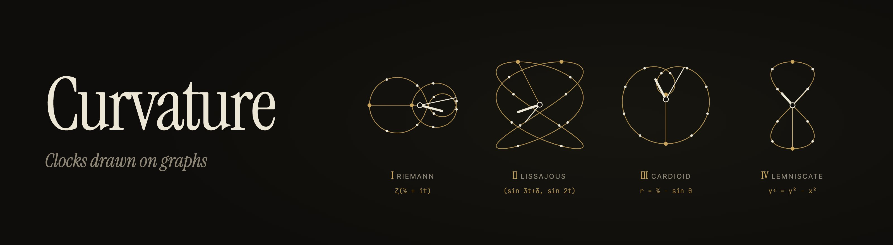
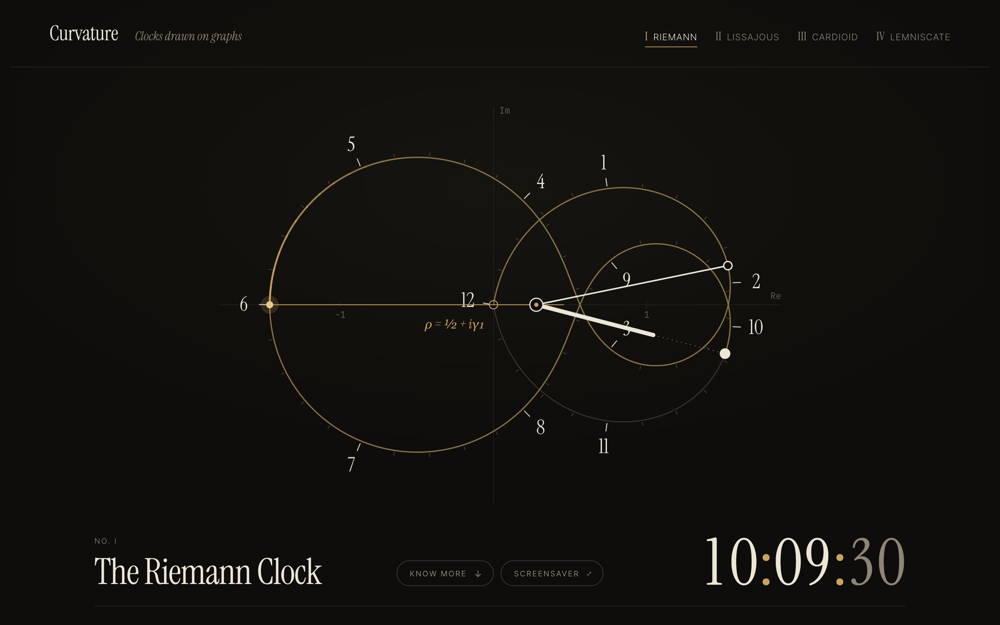
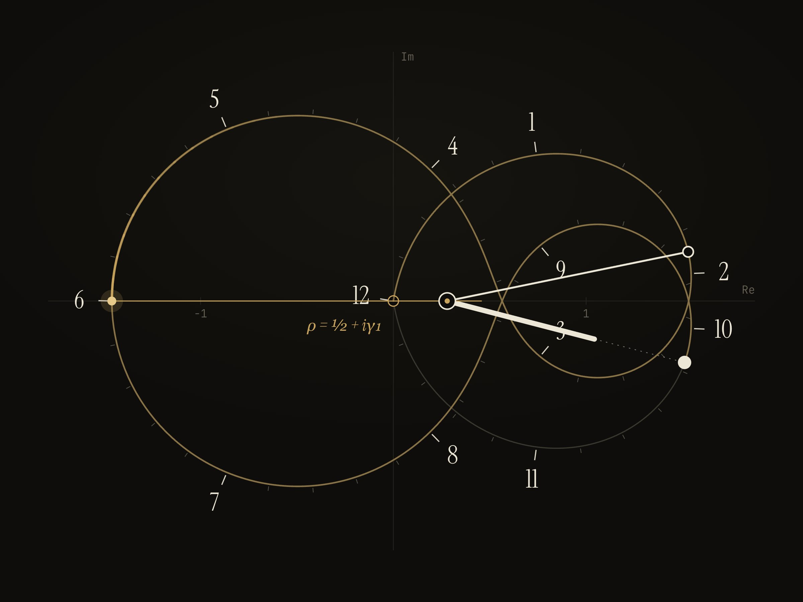
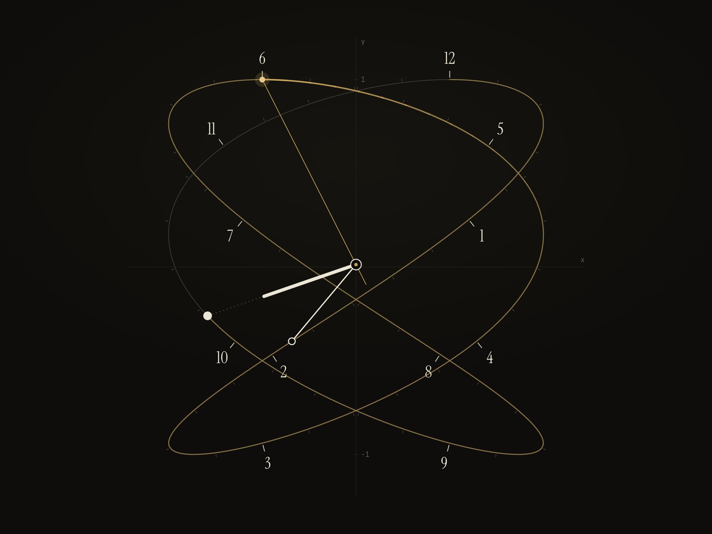
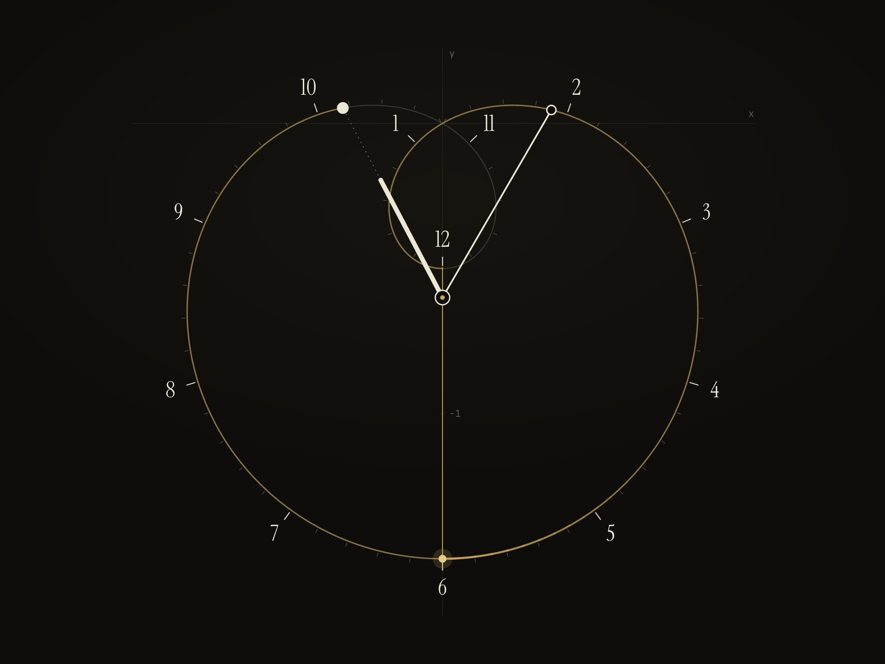
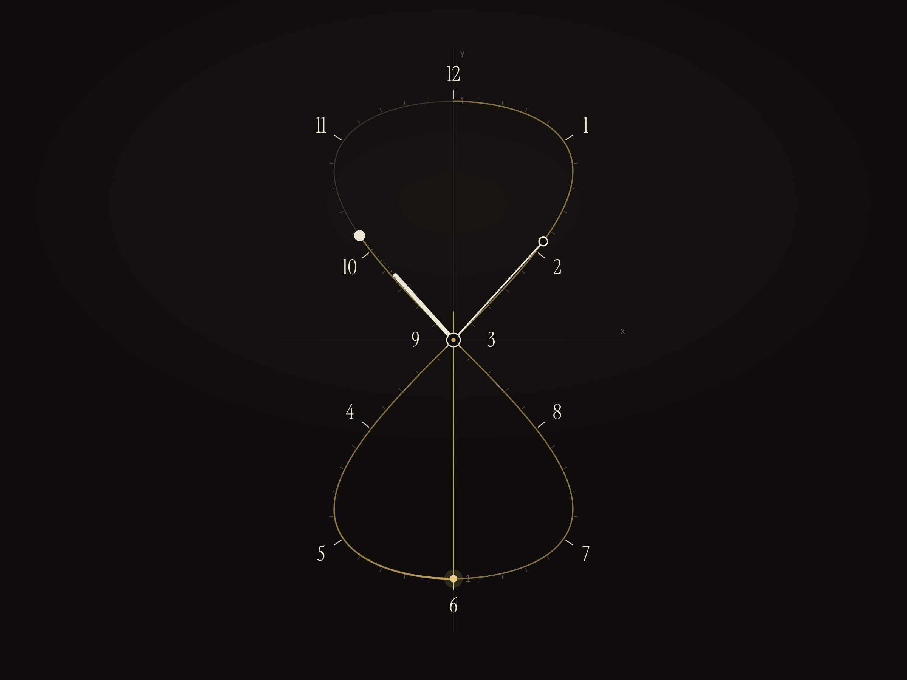
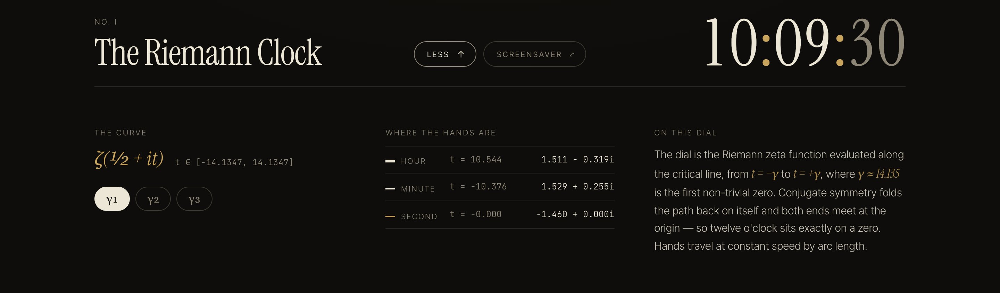
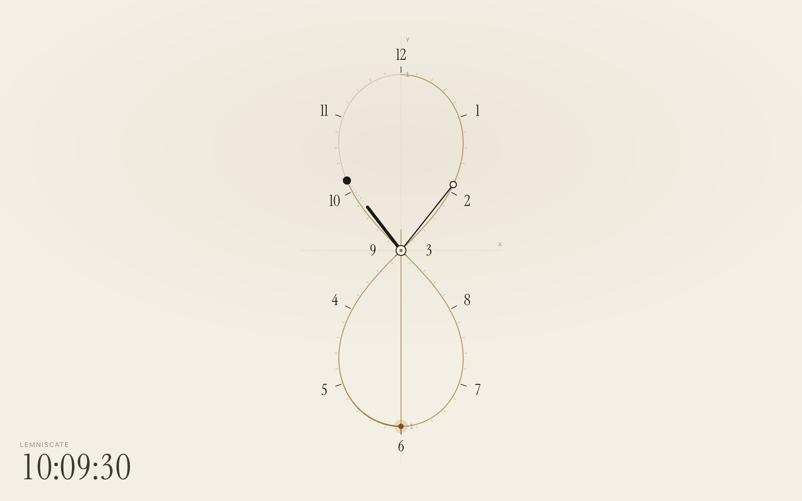
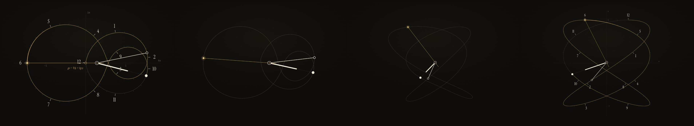
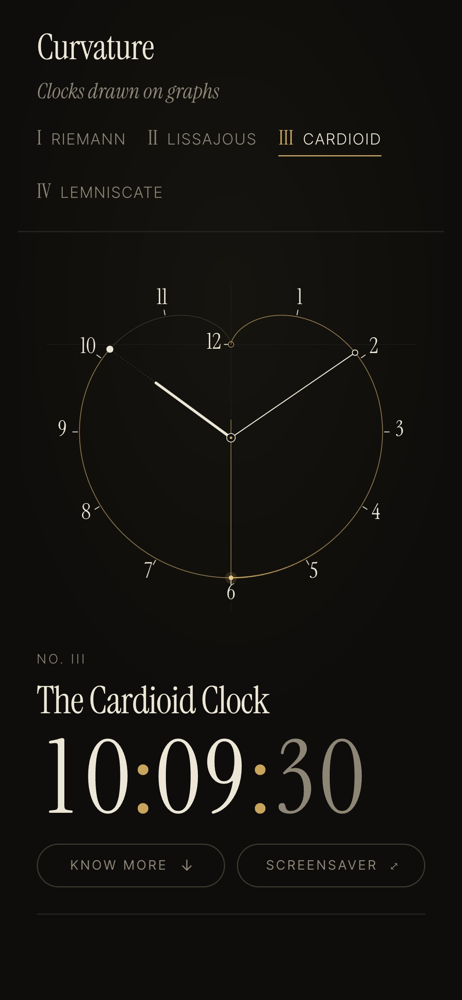

<picture>
  <source media="(prefers-color-scheme: light)" srcset="docs/images/banner-light.jpg">
  
</picture>

<p align="center">
  <b>Clocks whose dials are mathematical curves instead of circles.</b><br>
  The hands run along the Riemann zeta function, a Lissajous figure, a cardioid and a lemniscate.<br>
  <a href="https://clock.chiragghosh.dev">clock.chiragghosh.dev</a>
</p>

<p align="center">
  
</p>

A static site with no build step and no dependencies: plain HTML, CSS and ES modules, drawn in SVG.

## The clocks

<table>
  <tr>
    <td width="50%"></td>
    <td width="50%"></td>
  </tr>
  <tr>
    <td><b>No. I: Riemann.</b> ζ(½ + it) traced from t = −γ to t = +γ, where γ is a non-trivial zero. Because ζ(s̄) is the conjugate of ζ(s) the path is mirror-symmetric and both ends meet at the origin, so twelve o'clock sits exactly on a zero. Variants close on the 1st, 2nd or 3rd zero.</td>
    <td><b>No. II: Lissajous.</b> x = sin(at + δ), y = sin(bt). Whole-number frequencies (3 : 2, 3 : 4, 5 : 4) make the figure close after one period; twelve o'clock is on the top crest.</td>
  </tr>
  <tr>
    <td></td>
    <td></td>
  </tr>
  <tr>
    <td><b>No. III: Cardioid.</b> The limaçon family r = b − sin θ: the cardioid itself (b = 1, twelve on the cusp), one with an inner loop (b = ½, shown) and a dimpled one (b = 1½).</td>
    <td><b>No. IV: Lemniscate.</b> Bernoulli's and Gerono's figure-of-eight (Gerono shown), stood upright. The hands pivot on the node, so at three and nine they shrink to nothing as they cross into the other lobe.</td>
  </tr>
</table>

Every dial is divided into twelve hours by **arc length**, so the hands move at a steady speed however
the curve bends. The minute and second hands reach the curve, the hour hand is a short bar with a
dotted guide to its point, and the second marker trails a fading comet. The gold arc shows how much of
the dial the hour hand has swept since twelve.

## Know more

The page opens on the dial, the clock's name and the time, all in one screen. **Know more** unfolds the
formula, the variants, live readouts of where each hand is on the curve, and a note on the maths.

<p align="center">
  
</p>

## Screensaver

The **Screensaver** button, or `?screensaver` in the URL, shows just the dial and a small caption,
full screen with no scrolling. The cursor hides when idle, the dial drifts very slowly to spare the
screen, **F** or a double-click toggles full screen and **Esc** goes back to the page.

<p align="center">
  
</p>

```
/?screensaver                            Riemann
/?screensaver#lemniscate                 pick a clock with the hash
/?screensaver&variant=gerono#lemniscate  and a variant
```

Variant keys: `riemann` g1 g2 g3 · `lissajous` 3-2 3-4 5-4 · `cardioid` cardioid inner dimpled ·
`lemniscate` bernoulli gerono.

### Cycling screensaver

`?cycle` plays the clocks in turn and **morphs one dial into the next**: the numerals fade, the curve
bends into the next clock's curve while the hands keep time along it, and the new numerals fade in.
Because every dial is measured by arc length from twelve o'clock, each point flows to the matching point
on the next curve.

<p align="center">
  
</p>

```
/?cycle              next clock every 45 s
/?cycle=20           every 20 s (minimum 8)
/?cycle#cardioid     start part-way through
```

The playlist is Riemann γ₁ → Lissajous 3 : 2 → Cardioid b = ½ → Lemniscate (Gerono); change it in
`PLAYLIST` in [`js/main.js`](js/main.js).

## On a phone



The name, time and buttons stack under the dial, and the dial keeps its numerals legible. Light and dark
themes follow the system setting.

The clock is light to run. The dial is two stacked SVG layers: the curve, ticks and numerals are drawn
once, and only the hands redraw, at up to 30 frames a second. The digital time sits in fixed-width
digit slots, so it never jitters as the digits change.

<br clear="right">

## Run it

**Docker Compose** (nginx, with a `/healthz` check):

```sh
docker compose up -d --build           # http://localhost:4321
CLOCK_PORT=3000 docker compose up -d   # another port
docker compose down
```

**Locally**, with the zero-dependency Node server:

```sh
npm start                              # http://localhost:8000
```

The Docker image stamps every asset URL with a content hash and serves `Cache-Control: no-cache`, so a
redeploy shows up on the next load and never mixes old CSS or JS with new HTML.

## Tests

```sh
npm test               # unit + end-to-end (needs Playwright + Chromium)
npm run test:unit      # zeta accuracy, arc-length maths, every curve closes, clock contract
npm run test:e2e       # real browser: rendering, hands, 12:00 on the zero, variants, layout,
                       # screensaver, cycling, performance budget

docker compose --profile test run --rm e2e   # end-to-end against the container, inside Docker
```

Set `BASE_URL` to point `npm run test:e2e` at any deployed copy.

`npm run screenshots` regenerates the images in this README (in [`docs/images`](docs/images)) from
the live code, at a frozen 10:09:30.

## Adding a clock

Create `js/clocks/<name>.js` exporting
`{ id, numeral, name, title, formula, variants, describe, sample, readout }`
(optionally `marker(variant)`, `pivot` and `axes: 'complex'`), where `sample(variant)` returns a closed
list of `{x, y, t}` points. Register it in [`js/clocks/index.js`](js/clocks/index.js).
[`js/dial.js`](js/dial.js) does the rest: arc-length parametrisation, ticks, numerals, hands and morphing.
